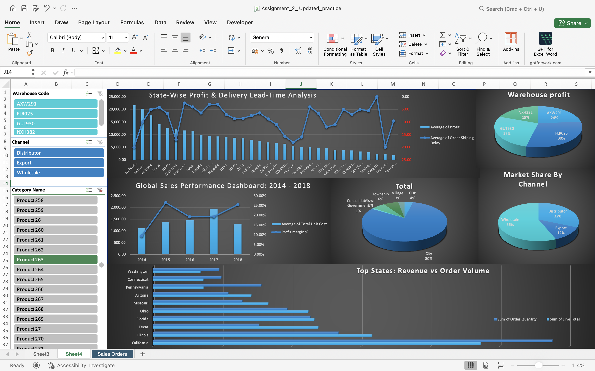

# Global Sales Performance Dashboard (Excel)

An interactive Excel dashboard that analyzes global sales performance from 2014 to 2018. It brings together revenue, profit, order volume, channel mix, warehouse contribution, and state-level performance in one filterable view.



## Business questions

- Which states generate the most revenue and profit?
- How does sales performance change over time?
- Which sales channels and warehouses contribute the most?
- How do order volume, revenue, profit margin, and shipping delay compare across locations?

## Dashboard highlights

- State-wise profit and delivery lead-time analysis
- Warehouse profit contribution
- Sales trend and profit-margin view for 2014 to 2018
- Channel and location market-share views
- Top-state comparison of revenue and order volume
- Interactive filters for warehouse, channel, and product category

## Dataset

The workbook includes **42,736 sales-order records** covering **1 January 2014 to 15 November 2018**. Each record contains customer, channel, warehouse, geography, product, quantity, sales, cost, profit, and shipping-delay fields.

| Metric | Value |
| --- | ---: |
| Sales orders | 42,736 |
| Unique order numbers | 10,684 |
| Total sales | 823,979,266 |
| Total profit | 307,848,373.28 |
| Overall profit margin | 37.36% |
| Units ordered | 360,764 |

## Key observations

- **California** is the highest-revenue state in the dataset, followed by Illinois, Florida, Texas, and Indiana.
- **Wholesale** is the largest sales channel by revenue, ahead of Distributor and Export.
- Sales peak in **2016** in the supplied data, while 2018 is a partial year through November.
- The dashboard enables comparisons between state profitability and order-shipping delay to help identify operational trade-offs.

## Repository structure

```text
.
├── assets/
│   └── global-sales-dashboard.png
├── data/
│   └── global_sales_dashboard_2014_2018.xlsx
├── LICENSE
└── README.md
```

## Tools and techniques

- Microsoft Excel
- PivotTables and PivotCharts
- Slicers for interactive filtering
- Dashboard design and data visualization

## How to use

1. Download `data/global_sales_dashboard_2014_2018.xlsx`.
2. Open it in the desktop version of Microsoft Excel for the full PivotTable, PivotChart, and slicer experience.
3. Select warehouse, channel, or category values in the filters to update the dashboard.

## Notes

The workbook is provided as a portfolio project and contains a historical snapshot. Values are presented in the source dataset's units and currency convention.

## Author

**Soumyadeep Masanta**  
GitHub: [@Soumyadeepmasanta](https://github.com/Soumyadeepmasanta)
